# Algorithm

This section describes the algorithm that lets a 6-DoF UR10e arm move its tool to a goal while staying clear of
obstacles, and how that skill is turned into a camera-guided pick-and-place (pineapple harvesting) system. The algorithm
was developed in two stages that share one control core:

* **Stage A — reach–avoid skill.** The arm learns to bring its tool centre point (TCP) to a target, to follow a straight
  line from an **enter point** to an **end point**, and to do so through a constellation of point obstacles. Target and
  obstacle positions are known exactly.
* **Stage B — camera-guided harvesting.** The same core is placed inside a pick-and-place pipeline. A wrist camera
  finds the fruit, a diffusion policy chooses the end point on the fruit and the enter point in front of it, and the arm
  approaches along the line enter point → end point, grips, detaches, carries and releases the fruit into a crate. The
  last configuration harvests a whole 15 m bed from a tracked carrier.

Both stages use the same decomposition: **select an approach line → validate it → follow it with a reference controller
→ add a small learned residual correction (Soft Actor-Critic) → convert the Cartesian command to joint targets with
inverse kinematics.** In this section the start of the approach line is always called the **enter point** and its end
the **end point**.

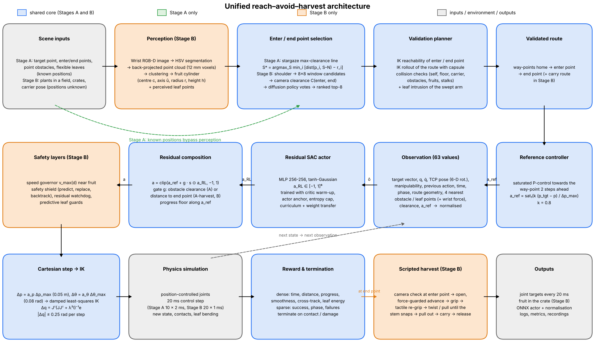

*Figure 1. Unified architecture. Blue blocks are shared by both stages, the green path exists only in Stage A (known
positions), orange blocks only in Stage B (camera perception, safety layers and the scripted harvest).*

---

## 1. Problem formulation and overall structure

### 1.1 Task

Let $`p \in \mathbb{R}^3`$ be the TCP position, $`q \in \mathbb{R}^6`$ the joint angles, $`E`$ the enter point, $`X`$ the end
point and $`\mathcal{O}=\lbrace (p_i, r_i) \rbrace`$ a set of obstacles (points or leaf segments with radius $`r_i`$). The common task
is

1. move from the home posture to $`E`$ without contact,
2. follow the segment $`\overline{EX}`$ with a small cross-track error until $`\lVert p - X\rVert`$ is below a threshold,
3. keep the whole arm body (not only the TCP) clear of $`\mathcal{O}`$, of itself and of the floor.

In Stage B the end point lies on the fruit, and the line is followed by a manipulation sequence (grip → detach → carry →
release). Success then means the fruit lies in the crate and the arm is back in its default posture.

### 1.2 Why the structure is "planner + reference + residual"

Learning the whole motion end to end was tried first. In Stage A the policy that produced the full action reached only
66–86 % on the evaluation tasks, and most of its failures were postures that folded the arm into itself or the floor,
although the scenario validator already knew a collision-free route. A 20-line controller that only followed that
route already scored 90–100 %. In Stage B a policy acting through the whole harvest trained for a long time without
improvement, because almost every failure occurred in parts where a correction has no influence (fruit not found, no
feasible line, grip slipped, a leaf torn while pulling out).

The final algorithm therefore separates the problem into:

| Part | What it decides | How |
|---|---|---|
| Line selection | *where* to go (enter point, end point) | max-clearance geometry (Stage A), camera + diffusion policy (Stage B) |
| Validation | *whether* the line is feasible for the whole arm | IK rollout + capsule collision checks (+ leaf intrusion) |
| Reference controller | *a baseline motion* along the validated route | saturated proportional controller |
| Residual SAC policy | *a bounded correction* of that motion (precision, speed) | off-policy reinforcement learning |
| Safety layers (Stage B) | *whether a command may be executed* | speed governor, predictive shield, leaf guards, watchdog |
| Scripted manipulation (Stage B) | grip, detach, carry, release | force-, leaf- and speed-guarded sequences |

### 1.3 Development path: one curriculum across both stages

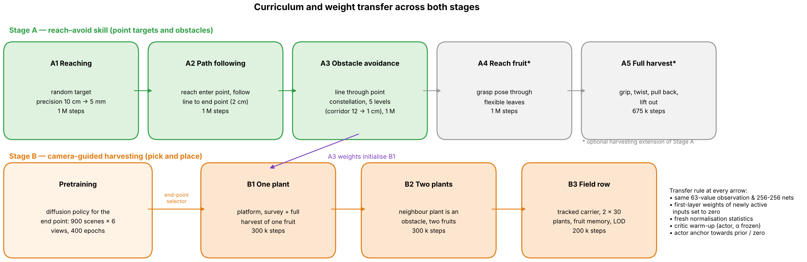

*Figure 2. The curriculum. Every mission starts from the weights of the previous one; the Stage A obstacle-avoidance
policy (A3) initialises the first harvesting mission (B1). A4–A5 are an optional harvesting extension of Stage A that
motivated the redesign in Stage B.*

| Mission | Scene | New element | Success criterion | Episode limit |
|---|---|---|---|---|
| A1 Reaching | random target in a ring around the robot (r 0.35–0.48 m, z 0.25–0.45 m above the base) | adaptive precision 10 → 5 → 2 → 1 → 0.5 cm | TCP within the current threshold (final 5 mm) | 200 steps |
| A2 Path following | reach the enter point, then follow the line to the end point (0.15–0.50 m) | phase flag, line features, cross-track penalty | end point within 2 cm | 300 steps |
| A3 Obstacle avoidance | as A2, through a constellation of 3–5 point obstacles per cube face | obstacle features, potential shaping, 5 difficulty levels | end point within 2 cm, no obstacle contact | 350 steps |
| A4 Reach fruit (optional) | random pineapple plant with flexible blocking leaves | approach line on leaf points, gripper orientation | TCP ≤ 1.5 cm and ≤ 12° from the grasp pose | 300 steps |
| A5 Full harvest (optional) | A4 + grip, twist, pull back, lift | rule-based detachment | fruit detached and carried out | 450 steps |
| B pretraining | camera views around realistic plants | diffusion policy for the end point | — | — |
| B1 One plant | one plant 0.55–0.80 m from a 1.15 m platform, any azimuth | camera survey and full harvest | fruit in the crate, arm home | — |
| B2 Two plants | B1 + neighbour plant 42–55 cm away | neighbour fruit, crown and stalk are obstacles | both fruits in the crate | — |
| B3 Field row | tracked carrier on a zig-zag double row, 2 × 30 plants over 15 m | driving, fruit memory, two crates, level of detail | row finished; fruits in crates counted | — |

---

## 2. Inputs

### 2.1 Robot, gripper and timing

| | Stage A | Stage B |
|---|---|---|
| Arm | UR10e (official kinematics and dynamics), position-controlled joints with gravity compensation | same |
| Gripper | parallel gripper (A4–A5: approximation of a 140 N parallel gripper, finger gap 30–110 mm) | U-jaw parallel gripper, pad gap 11.65 cm closed / 16.65 cm open, 100 N per jaw |
| Sensors | joint encoders, wrist force (A4–A5); exact target and obstacle positions | joint encoders, wrist force, **RGB-D wrist camera** (640 × 480, 58° vertical field of view) |
| Control period | 20 ms (10 physics sub-steps of 2 ms) | 20 ms (20 physics sub-steps of 1 ms) |
| Platform | fixed base | fixed platform (B1–B2), tracked carrier with two crates (B3) |

### 2.2 Scene inputs

| Input | Stage A | Stage B |
|---|---|---|
| Goal | target point (A1), enter and end point (A2–A3), grasp pose (A4–A5) | **not given**: estimated from the camera |
| Obstacles | point obstacles of radius 15 mm (A3), capsule-chain leaves (A4–A5) | perceived leaf points, other fruits, stalks, crowns, carrier, crates |
| Plants | procedural plant per episode (A4–A5) | 5 mesh pineapples, every leaf an articulated chain (2 spring hinges per segment), fruit 0.60–0.70 m above the ground, plant tilt 0–15° |
| Disturbances | payload +0–1 kg, gravity ×0.98–1.02, observation noise σ = 0.005, initial joint noise 0.05 rad | camera noise (below), random plants and field layouts |

### 2.3 Perception (Stage B)

Nothing in the motion pipeline of Stage B reads the fruit position from the simulator; the ground truth is used only to
report the estimation error. The camera image carries simulated noise: RGB σ = 5, brightness ×0.8–1.2, depth noise
0.6 % + 2 mm, 1 % invalid depth pixels and a calibration error of 0.3° / 3 mm.

1. **Segmentation.** Pixels are classified in HSV: fruit (hue 21–34), leaves (hue 36–90) and orange leaf tips (hue 4–18,
   high saturation). Leaf-coloured pixels on the robot's own carrier are removed.
2. **Back-projection.** A classified pixel $`(u, v)`$ with depth $`z`$ becomes the world point

   ```math
   P = R_c\,z\,K^{-1}
   \begin{bmatrix}
   u \\
   v \\
   1
   \end{bmatrix} + t_c ,
   ```

   with camera intrinsics $`K`$ and the calibrated camera pose $`(R_c, t_c)`$. Points are voxelised (12 mm) and clustered by
   single linkage (radius 35 mm, at least 25 points).
3. **Fruit model.** Each fruit cluster is fitted with a cylinder: centre $`c`$, unit axis $`\hat u`$ (tilt ≤ 18°), radius
   $`r \in [6.0, 7.6]`$ cm, height $`h \in [14, 22]`$ cm. Clusters whose centre lies outside 0.48–0.84 m above the ground are
   rejected (yellow leaf tips near the soil were otherwise detected as fruit).
4. **Survey with early stop.** Detections from several views (B1–B2: up to 8 views on a 0.40 m circle; B3: 3 views) are
   merged. Only a detection with confidence ≥ 0.85 ends the survey; weaker detections were found to be leaf tips or
   fruits seen through leaves and misplaced by 3–8 cm. The arm then moves to one **close view** 0.55 m from the fruit.

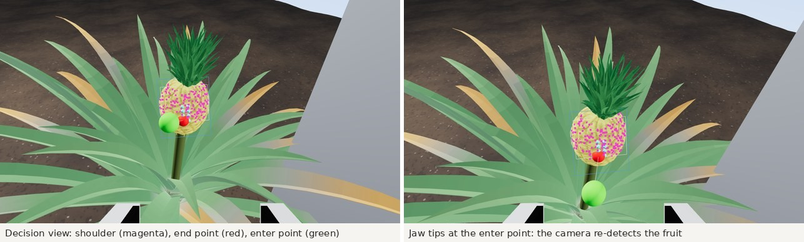

*Figure 3. Wrist-camera views. Left: decision view with the fruit shoulder (magenta), the chosen end point (red) and
enter point (green). Right: with the jaw tips at the enter point the camera detects the fruit again before the line is
followed.*

---

## 3. Selecting the enter point and the end point

The core idea of both stages is the same: **among all straight approach lines into the goal, choose the one whose
distance to the nearest obstacle is largest.** Stage A applies it to known points; Stage B applies it to what the camera
sees and lets a learned model pick among the candidates.

### 3.1 Max-clearance line on known obstacles (Stage A)

The end point $`N`$ (the *nucleus*) is surrounded by three nested cubes with half-sizes 0.1, 0.2 and 0.3 m. On each face
3–5 obstacle points are scattered over the three layers (a 3 × 3 grid per layer, at most one point per cell, jitter
0.35 of a cell). Candidate enter points $`S`$ lie on a regular grid of the outer cube faces. The face opposite the robot
and the bottom face are excluded. For obstacle points $`p_i`$ with radius $`r_i`$, the clearance of the segment
$`\overline{SN}`$ is

```math
C(S) = \min_i \Big(\mathrm{dist}\big(p_i, \overline{SN}\big) - r_i\Big),
\qquad
\mathrm{dist}(p, \overline{SN}) = \big\lVert p - (N + t^{\ast}(S - N)) \big\rVert,\quad
t^{\ast} = \mathrm{clip}\!\left(\frac{(p - N)\cdot(S - N)}{\lVert S - N\rVert^2}, 0, 1\right),
```

and the enter point is $`E = S^{\ast} = \arg\max_S C(S)`$, restricted to candidates the arm can reach. The distance is
taken to the **segment**, not the infinite line, because the tool only travels between the two points. The same rule
was applied to leaf points in A4–A5, with the grasp point as nucleus.

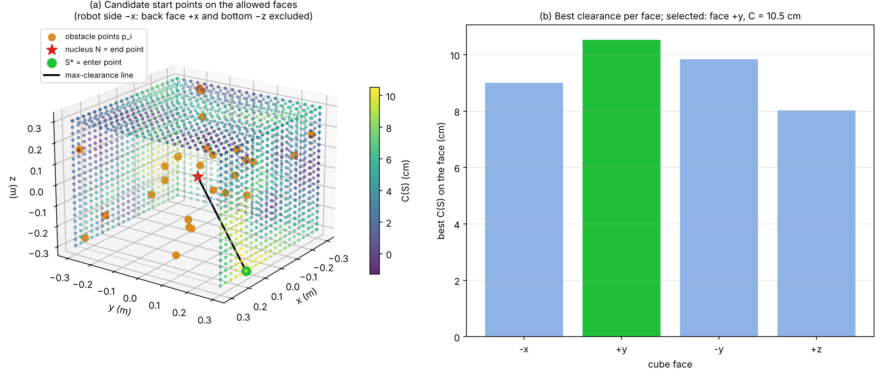

*Figure 4. The max-clearance rule on one sampled constellation (26 obstacle points). (a) Candidate start points
coloured by $`C(S)`$; the selected line (black) ends at the nucleus = end point. (b) Best clearance per allowed face.*

### 3.2 Camera-based candidates (Stage B)

In Stage B the obstacle set is the perceived leaf point cloud, and the end point must lie on the **visible** part of the
fruit:

* **Shoulder** = fruit pixels between the fruit centre and the crown base. Parts of the fruit hidden by leaves are not
  fruit pixels, so they can never be chosen.
* **Window** = image bounding box of the shoulder, divided into an 8 × 8 grid. Every cell with at least 3 shoulder pixels
  gives one end-point candidate $`X`$ (the median of its 3-D points).
* **Enter point.** For an outward direction $`\hat d`$ with elevation in {−10°, 0°, 10°, 20°, 30°, 40°},
  $`E = X + L\,\hat d`$ with $`L = 0.20`$ m; $`E`$ must project inside the window.
* **Camera clearance score** of a candidate line, with perceived leaf points $`p_i`$ of radius $`\rho = 15`$ mm:

```math
C(E, X) = \min_i \Big(\mathrm{dist}\big(p_i, \overline{EX}\big) - \rho\Big) + 0.5\,\min_i\big(\lVert p_i - X\rVert - \rho\big).
```

The first term is the Stage A segment clearance; the second keeps the end point itself away from leaves.

### 3.3 Diffusion policy for the end point (Stage B)

The camera score is computed from an incomplete point cloud: leaves behind the fruit or outside the view are missing.
A denoising diffusion model is therefore trained to propose end points whose *true* clearance is large, from what the
camera sees.

**Representation.** The action is the normalised window position of the end point, $`x_0 = (u, v) \in [-1, 1]^2`$. The
context is a 6 × 8 × 8 feature grid (shoulder occupancy, camera clearance of the end point, camera line clearance,
height on the shoulder, leaf-pixel occupancy, valid-candidate mask) plus 5 global features (window size, shoulder ratio,
fruit radius, camera elevation).

**Forward process** (DDPM, $`T = 50`$ steps, cosine schedule $`\bar\alpha_t = f(t)/f(0)`$,
$`f(t) = \cos^2\!\big(\tfrac{t/T + s}{1+s}\tfrac{\pi}{2}\big)`$, $`s = 0.008`$):

```math
x_t = \sqrt{\bar\alpha_t}\,x_0 + \sqrt{1 - \bar\alpha_t}\,\epsilon,\qquad \epsilon \sim \mathcal{N}(0, I).
```

**Training loss** of the noise predictor $`\epsilon_\theta`$ conditioned on the context $`c`$:

```math
\mathcal{L}(\theta) = \mathbb{E}_{x_0, t, \epsilon}\Big[\big\lVert \epsilon - \epsilon_\theta(x_t, t, c)\big\rVert^2\Big].
```

**Sampling** (deterministic DDIM with 10 steps $`t_k`$, $`\bar\alpha_{t_{K+1}} = 1`$):

```math
\hat x_0 = \mathrm{clip}\!\left(\frac{x_{t_k} - \sqrt{1 - \bar\alpha_{t_k}}\,\epsilon_\theta(x_{t_k}, t_k, c)}{\sqrt{\bar\alpha_{t_k}}}, -1.2, 1.2\right),
\qquad
x_{t_{k+1}} = \sqrt{\bar\alpha_{t_{k+1}}}\,\hat x_0 + \sqrt{1 - \bar\alpha_{t_{k+1}}}\,\epsilon_\theta(x_{t_k}, t_k, c).
```

**Network.** A small CNN encodes the grid (6 → 32 → 32 → 16 channels, 3 × 3, 3 × 3, 1 × 1 kernels, ReLU); an MLP maps the
encoding and the global features to a 128-D context; the noise predictor is an MLP (inputs $`x_t`$, a 32-D sinusoidal
time embedding and the context; three hidden layers of 256 with SiLU; 2 outputs).

**Labels.** Training views were generated around 900 realistic plants (6 views each, camera radius 0.45–0.85 m,
elevation 15–60°), giving 4852 usable views. For each view the label is the candidate with the largest **true** line
clearance computed from the full leaf geometry; every candidate within 90 % of the best is treated as a valid mode, so
the model learns a multi-modal distribution of good end points. Training: 400 epochs, batch 256, learning rate 1e-3,
4367 training / 485 validation views.

**Decision.** At run time $`K = 24`$ samples are drawn and each votes for its nearest candidate. Candidates with at least
$`\max(2, 0.12K)`$ votes form the **proposal set**. Inside it, the line with the largest camera clearance comes first, then
the remaining cells by votes. The ranked top 8 lines go to the planner, which takes the first one that validates.

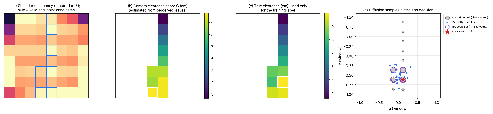

*Figure 5. One held-out view (chosen for illustration). (a) Shoulder occupancy and the valid candidates. (b) Camera
clearance score; the white box is the camera-best cell. (c) True clearance, used only to create training labels; the
white box is the oracle. (d) 24 diffusion samples, votes, proposal set and the chosen end point, which here coincides
with the oracle while the camera-best cell does not. Over all 485 held-out views the policy picks the best candidate in
93.6 % of the views (Section 8.4).*

---

## 4. Route validation and inverse kinematics

### 4.1 Validation

Every scenario (Stage A) or candidate line (Stage B) is checked before the arm moves:

* IK reachability of the enter point, the end point and (Stage B) the advance end point (Stage B tolerances 3 mm and
  0.04 rad; Stage A 2 mm);
* an **IK rollout** of the route home → enter point → end point (Stage A: 4 cm way-points), with the robot body represented by
  capsules and checked against itself, the floor, the carrier and crates (Stage B), obstacles, perceived fruits, crowns
  and stalks (hard margin 25 mm on the approach and 8 mm on the line in Stage B);
* wrist-singularity checks along the route (A4–A5, Stage B);
* in Stage B, the **leaf intrusion** of the swept arm, compared between up to 4 collision-free candidate paths.

In A3 the validator additionally removes obstacles that the robot body would sweep through when following the route,
and keeps only those farther than the current corridor width from the swept body. Every scenario therefore has at
least one collision-free solution, and the curriculum shrinks that corridor from 12 cm to 1 cm. The validated route is
what the reference controller follows. In Stage B free-space moves between camera poses use timed trapezoidal joint
trajectories (2.0 rad/s, 7.5 rad/s², slower within 6 cm of a perceived fruit).

### 4.2 Damped least-squares inverse kinematics

For a target pose $`(p^{\ast}, q^{\ast})`$ (position and unit quaternion), the solver iterates from the current joint
state:

```math
e = \begin{bmatrix}
p^{\ast} - p(q) \\
w_r\,\mathrm{Log}\big(q^{\ast} \otimes q(q)^{-1}\big)
\end{bmatrix},
\qquad
\Delta q = J_w^{\top}\big(J_w J_w^{\top} + \lambda^2 I\big)^{-1} e_w ,
```

with rotation weight $`w_r = 0.5`$, a step limit of 0.3 rad, up to 60 iterations and tolerances of 0.1 mm and 0.002 rad.
The damping grows near singularities, measured by the manipulability $`w = \sqrt{\det(J_p J_p^{\top})}`$:

```math
\lambda = \lambda_{\min} + (\lambda_{\max} - \lambda_{\min})\,\mathrm{clip}\!\left(1 - \frac{w}{w_0}, 0, 1\right),
\qquad \lambda_{\min} = 10^{-4},\ \lambda_{\max} = 0.05,\ w_0 = 0.02 .
```

The solution is clamped to the joint limits and unwrapped to the configuration closest to the current one.

---

## 5. Learned control along the route

### 5.1 Markov decision process

The learned phases are an episodic MDP $`(\mathcal{S}, \mathcal{A}, P, r, \gamma)`$ with a control period of 20 ms.
In Stage B the learned correction acts only in the phases *approach to the enter point* and *line enter point → end point*.

**Action.** $`a = [a_p, a_\theta] \in [-1, 1]^6`$. The commanded tool motion per step is

```math
\Delta p = a_p\,\Delta p_{\max},\qquad \Delta\theta = a_\theta\,\Delta\theta_{\max},\qquad
\Delta p_{\max} = 0.05\ \text{m},\ \Delta\theta_{\max} = 0.08\ \text{rad}.
```

The target orientation is integrated in the world frame, $`q^{\ast}_{t+1} = \exp(\Delta\theta) \otimes q^{\ast}_t`$, and kept
within a cone around the nominal orientation (30° in A1–A3; opened in the harvesting missions, where the gripper must
turn). The IK solution is limited to $`\lvert q_{\text{cmd}} - q\rvert \le 0.25`$ rad per joint and step. In Stage B the
joint servos have a rate of $`k_s = 10\ \text{s}^{-1}`$, so $`\lVert a_p\rVert = 1`$ corresponds to a hand speed of 0.5 m/s.

**Observation.** One fixed layout of **63 values** is used in every mission of both stages, so the network weights can
be transferred directly. Fields that a mission does not use are held constant.

| Field | Size | Meaning | Active from |
|---|---|---|---|
| `rel_target` | 3 | active target − TCP position | A1 |
| `q`, `qd` | 6 + 6 | joint angles and velocities | A1 |
| `tcp_pos`, `tcp_rot6` | 3 + 6 | TCP position; first two columns of the TCP rotation matrix (continuous 6-D rotation representation) | A1 |
| `manip` | 1 | manipulability $`w`$ (singularity indicator) | A1 |
| `prev_action` | 6 | previous executed action | A1 |
| `time_left` | 1 | $`1 - t/T_{\max}`$ (remaining step budget) | A1 |
| `phase` | 1 | Stage A: 0 = to enter point, 1 = along the line (A5: 2 pull back, 3 lift); Stage B: approach, line, retreat, lift, transport | A2 |
| `path_dir`, `cross_track_vec`, `path_progress` | 3 + 3 + 1 | unit vector of the current route piece, vector to its closest point, progress 0…1 | A2 |
| `obs_rel`, `obs_dist` | 12 + 4 | vectors and distances from the closest robot point to the 4 nearest obstacles (harvesting: leaf points; the 4th slot carries the wrist force) | A3 |
| `min_clearance` | 1 | minimum clearance of the whole robot body | A3 |
| `ref_action` | 6 | the reference controller's action in this state | A1 |

**Normalisation.** Running mean and variance give $`\hat o = \mathrm{clip}\big((o - \mu)/\sqrt{\sigma^2 + \epsilon}, -10, 10\big)`$
with $`\epsilon = 10^{-8}`$. After a transfer the statistics are frozen, because updating them would shift the inputs of
the transferred policy. The statistics are stored inside the exported policy graph.

### 5.2 Reference controller

The reference controller is a saturated proportional controller towards a look-ahead point of the validated route:

```math
a_{\text{ref},p} = \mathrm{sat}_1\!\left(\frac{k\,(p_{\text{tgt}} - p)}{\Delta p_{\max}}\right),\qquad
\mathrm{sat}_1(v) = \begin{cases} v & \lVert v\rVert \le 1 \\ v / \lVert v\rVert & \text{otherwise} \end{cases},\qquad k = 0.8,
```

where $`p_{\text{tgt}}`$ is the way-point two steps ahead of the closest one (approach) or the active target (line). In
A1–A3 the reference does not rotate the gripper. In the harvesting missions it also turns towards the planned grasp
orientation, $`a_{\text{ref},\theta} = \mathrm{sat}_1\!\big(k_\theta \mathrm{Log}(q_{\text{des}} \otimes q^{\ast -1})/\Delta\theta_{\max}\big)`$, and
Stage B scales its speed per phase (approach 1.4, line 0.7, pull-out 0.5, lift 1.0, transport 1.4).

### 5.3 Residual composition, gates and progress floor

The executed action is

```math
a = \mathrm{clip}\big(a_{\text{ref}} + g \cdot s \odot a_{\text{RL}},\ -1,\ 1\big),
```

with residual scale $`s = [0.5, 0.5, 0.5, s_\theta, s_\theta, s_\theta]`$ (so the correction changes the tool position by at
most 2.5 cm per step; $`s_\theta`$ = 1.0 in A1–A2, 0 in A3, 0.5 in A4–A5 and Stage B). The gate $`g \in [0, 1]`$ fades the
correction out where a wrong correction is most costly:

```math
g_{\text{obstacle}} = \mathrm{clip}\!\left(\frac{c_{\min} - 0.02}{0.08 - 0.02}, 0, 1\right)\ \text{(A3)},\qquad
g_{\text{target}} = \mathrm{clip}\!\left(\frac{d_X - 0.04}{0.10 - 0.04}, 0, 1\right)\ \text{(A4–A5, Stage B)},
```

where $`c_{\min}`$ is the minimum robot–obstacle clearance and $`d_X`$ the distance to the end point. A **progress floor**
keeps the component of $`a_p`$ along $`a_{\text{ref},p}`$ at least $`\rho\,\lVert a_{\text{ref},p}\rVert`$ (with $`\rho = 0.4`$ in A4–A5,
0.25 in Stage B): the correction can steer and slow down but cannot stop the arm.

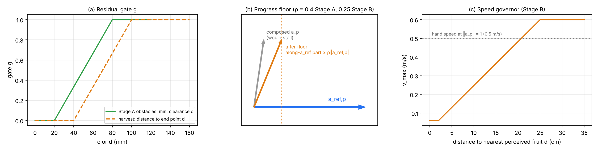

*Figure 6. (a) The two residual gates. (b) The progress floor. (c) The speed governor of Stage B (Section 5.4).*

### 5.4 Safety layers (Stage B)

**Speed governor.** With $`d`$ the distance from the tool to the nearest fruit the camera has perceived,

```math
v_{\max}(d) = v_{\text{near}} + (v_{\text{free}} - v_{\text{near}})\,\mathrm{clip}\!\left(\frac{d - d_{\text{near}}}{d_{\text{free}} - d_{\text{near}}}, 0, 1\right),
\qquad
a_p \leftarrow a_p \cdot \min\!\left(1, \frac{v_{\max}(d)}{\lVert a_p\rVert\,\Delta p_{\max}\,k_s}\right),
```

with $`v_{\text{near}} = 0.06`$ m/s at $`d_{\text{near}} = 2`$ cm and $`v_{\text{free}} = 0.60`$ m/s beyond $`d_{\text{free}} = 25`$ cm. It applies
to the reference action and to the composed action alike.

**Safety shield.** Before a step is executed, the commanded posture is checked for contact and safety margin; motion
that does not reduce the clearance is still allowed inside the margin. If the shield holds the arm for 5 steps after
the residual has acted, the arm goes back through its own recent postures to the start of the phase and finishes this
fruit with the reference controller alone; after 10 steps the route is planned again (at most twice), after 50 steps the
fruit is given up.

**Residual watchdog.** No progress along the route for 60 steps (1.2 s), or 3 shield interventions in one phase,
switches the residual off for the rest of that phase.

**Predictive leaf guard.** Leaves are chains of bodies with spring hinges. A hinge bent beyond 0.9 rad counts as leaf
damage; the root hinge bent beyond $`\theta_{\text{uproot}} = 1.15`$ rad means the leaf is torn out. With $`\theta_r`$ the bend
of the most loaded leaf root and $`\dot\theta_r`$ its change per step, a guard with fraction $`f`$ trips when

```math
\theta_r + n_{\text{lead}}\,\max(0, \dot\theta_r) > f\,\theta_{\text{uproot}},\qquad n_{\text{lead}} = 5,
```

with $`f = 0.85`$ on the line (back out to the enter point, new camera view, plan again), $`f = 0.75`$ during view moves (stop,
retrace, skip that view) and $`f = 0.80`$ while carrying (stop, re-plan the carry with the other pull-out direction).

### 5.5 Reward

All learned phases share four dense terms, with $`d_t`$ the distance from the TCP to the active target:

```math
r^{\text{common}}_t = \underbrace{-0.02}_{\text{time}} \;\underbrace{-\,w_d\,d_t}_{\text{distance}}
\;+\;\underbrace{20\,(d_{t-1} - d_t)}_{\text{progress}} \;\underbrace{-\,0.05\,\lVert a_t - a_{t-1}\rVert^2}_{\text{smoothness}},
\qquad w_d = 0.5\ \text{(Stage A)},\ 0.05\ \text{(Stage B)}.
```

The progress term is symmetric (moving away costs as much as moving closer earns), so it adds no bias. In Stage B the
distance weight was reduced tenfold because the distance term summed to about −80 per successful episode and a failed
episode could return more than a successful one.

From A2 on, a cross-track term $`-150\,\min(d_\perp, 0.08)^2`$ penalises the distance $`d_\perp`$ to the line (capped so the
value loss cannot explode). The harvesting missions add an orientation term $`-0.5\,\theta_{\text{err}}`$ on the line and a
leaf-energy term

```math
-0.15\,\min\!\big(E_{\text{leaf}}/0.1\ \text{J},\ 3\big),\qquad E_{\text{leaf}} = \tfrac{1}{2}\sum_j k_j\,\theta_j^2 ,
```

with $`\theta_j`$ the deflection of leaf hinge $`j`$ and $`k_j`$ its stiffness.

**Potential-based obstacle shaping (A3).** With $`c`$ the minimum robot–obstacle clearance,

```math
\Phi(c) = \begin{cases} -k_\Phi\left(\dfrac{1}{c + \varepsilon} - \dfrac{1}{d_{\text{safe}} + \varepsilon}\right) & c < d_{\text{safe}} \\ 0 & \text{otherwise} \end{cases},
\qquad F_t = \gamma\,\Phi(c_{t+1}) - \Phi(c_t),
```

with $`k_\Phi = 0.3`$, $`\varepsilon = 0.01`$ m and $`d_{\text{safe}} = 0.12`$ m. Potential-based shaping does not change the optimal
policy, and unlike a per-step penalty it does not make standing still near an obstacle cheaper than moving.

**Sparse terms.**

| Mission | Events |
|---|---|
| A1 | success $`+10 \cdot 1.2^{\ell}`$ (curriculum level $`\ell`$); self/floor contact −10 and terminate |
| A2 | enter point reached +5; success +20 |
| A3 | as A2, success +40; obstacle contact −100 and terminate |
| A4 | timeout −20; plant or leaf damage −50; success +40 |
| A5 | as A4, plus grip +10, detachment +10, harvest failure −30, success at the exit point +40 |
| Stage B | phase reached / fruit gripped / stem snapped +5 / +10 / +10; fruit in the crate +60 each; all fruits placed and arm home +30; any failure −40 once; on top: self/floor contact −10, leaf torn out or plant/other fruit hit or fruit knocked off −20, fruit dropped or missed the crate −10; each new leaf-damage event −5; step replaced by the shield −0.5 |

### 5.6 Soft Actor-Critic and the modifications used here

SAC maximises the entropy-regularised return $`\mathbb{E}\big[\sum_t \gamma^t (r_t + \alpha\,\mathcal{H}(\pi(\cdot\mid s_t)))\big]`$.
The actor is a tanh-squashed Gaussian, $`\tilde a = \tanh(\mu_\phi(s) + \sigma_\phi(s)\,\xi)`$, $`\xi \sim \mathcal{N}(0, I)`$. Two
critics $`Q_{\psi_1}, Q_{\psi_2}`$ with slowly updated target copies $`\bar\psi_i`$ are trained on replayed transitions:

```math
y = r + \gamma(1 - d)\Big(\min_i Q_{\bar\psi_i}(s', a') - \alpha \log \pi_\phi(a'\mid s')\Big),\quad a' \sim \pi_\phi(\cdot\mid s'),
\qquad
J_Q(\psi_i) = \tfrac{1}{2}\,\mathbb{E}\big[(Q_{\psi_i}(s, a) - y)^2\big],
```

```math
\bar\psi_i \leftarrow \tau\,\psi_i + (1 - \tau)\,\bar\psi_i,\qquad \tau = 0.005 .
```

The actor loss adds two terms to the standard one:

```math
J_\pi(\phi) = \mathbb{E}\Big[\alpha \log \pi_\phi(\tilde a\mid s) - \min_i Q_{\psi_i}(s, \tilde a)\Big]
\;+\; \lambda_\mu\,\mathbb{E}\big[\mu_\phi(s)^2\big]
\;+\; w_t\,\overline{\lvert Q\rvert}\;\mathbb{E}\big[(\tanh\mu_\phi(s) - a_{\text{prior}}(s))^2\big].
```

* **Mean regulariser** $`\lambda_\mu = 10^{-3}`$ keeps the pre-tanh mean out of the saturated region, where gradients vanish.
* **Actor anchor** (TD3+BC style, scaled by the mean absolute Q value) pulls the actor towards $`a_{\text{prior}}`$: either
  the zero correction ("do what the reference does") or the policy inherited from the previous mission. Its weight
  $`w_t`$ decays linearly to a floor that is never zero; without the floor the critic's over-estimation was exploited as
  soon as the anchor vanished (measured in Stage A: Q rose from 26 to 71 while success fell from 90 % to 10 %).
* **Critic warm-up.** After a transfer, the actor **and** the temperature $`\alpha`$ are frozen for the first steps and
  only the critics learn the new task. Freezing $`\alpha`$ as well fixed a collapse in A3: the automatically tuned
  temperature grew from 0.033 to 6.8 while the actor was frozen, and success fell from 63 % to 0 %.
* **Temperature.** Either tuned with $`J(\alpha) = \mathbb{E}[-\alpha(\log\pi(a\mid s) + \bar{\mathcal{H}})]`$ towards a target
  entropy $`\bar{\mathcal{H}}`$ and capped at $`\alpha_{\max}`$, or fixed.
* **Update-to-data ratio.** One gradient step per vector step of several parallel environments (0.25 with 4
  environments in Stage A) was more stable and about 3× faster than one step per transition.

| Hyperparameter | Stage A | Stage B |
|---|---|---|
| Networks (actor, both critics) | MLP [256, 256], ReLU | same (required for transfer) |
| Learning rate (Adam) | 3e-4 (A1), 1e-4 (A2), 1.5e-4 (A3–A5) | 1.5e-4 |
| Discount $`\gamma`$, Polyak $`\tau`$ | 0.995, 0.005 | 0.99, 0.005 |
| Replay buffer | 1 M transitions (250 k per environment) | 300 k |
| Batch size, learning starts | 256, 5000 | 256, 2000 (B3: 800) |
| Train frequency / gradient steps | 1 / 1 per vector step (4 envs) | 2 / 1 |
| Temperature | auto from 0.01, target −8, cap 0.05 / 0.02 (A1–A2); fixed 0.005 (A3–A5) | auto from 0.005, target −6, cap 0.02 |
| Initial log-std of the correction | −1.6 | −1.6 |
| Critic warm-up | 20 000–25 000 steps | 3000 steps (B3: 800) |
| Actor anchor (start / decay / floor) | 0.4 / 100–150 k / 0.10–0.20 | 1.0 / 30 k / 0.05 |
| Training steps | 1 M per mission (A5 stopped at 675 k) | 300 k (B1, B2), 200 k (B3) |

### 5.7 Curriculum and weight transfer

* **Adaptive precision (A1).** Level $`\ell`$ uses the threshold $`\delta_\ell \in \lbrace 10, 5, 2, 1, 0.5 \rbrace`$ cm. The level advances
  when the success rate over the last 100 episodes reaches 85 % (checked every 50 episodes, at least 100 episodes per
  level). Only the success bonus grows with the level, so the dense terms keep their scale.
* **Difficulty levels (A3–A5).** The same rule with 80 % (55 % in A5). A3 shrinks the obstacle-free corridor
  (12 → 8 → 5 → 3 → 1 cm) and widens the reachable workspace; A4–A5 add blocking leaves, more rosette leaves and stiffer
  leaves.
* **Single task definition.** Evaluation always uses the last curriculum level of the training configuration, so
  training and evaluation numbers measure the same task.
* **Weight transfer.** All missions share the network shapes and the observation layout. For every input index $`j`$
  that becomes active, or changes meaning, in the new mission, the first-layer weights of the actor and both critics are
  set to zero, $`W^{(1)}_{:, j} \leftarrow 0`$, so the transferred policy initially ignores it. Its normalisation statistics
  are estimated from 8000 observations of the new mission. When the target is the zero correction, the residual output
  layer is restarted near zero, so behaviour starts exactly at the reference controller.

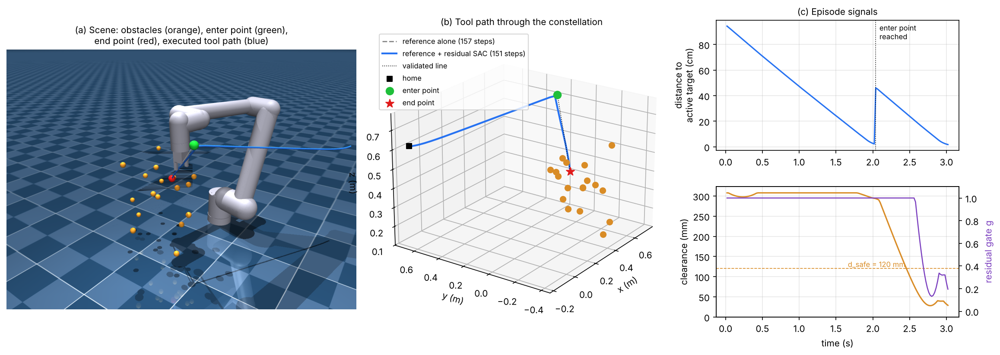

*Figure 7. One A3 test episode at the final level (18 obstacles, unseen seed). (a) Scene with the executed tool path.
(b) Tool path of the reference alone (dashed, hidden under the blue path) and with the residual correction; both succeed,
the correction in 151 instead of 157 steps. (c) Distance to the active target (the jump marks the switch from the enter
point to the end point), minimum body–obstacle clearance and the obstacle gate $`g`$, which fades the correction out as the
clearance falls below 80 mm.*

---

## 6. Scripted manipulation and execution at field scale

### 6.1 Harvest sequence (Stage B)

| Step | What happens | Guard |
|---|---|---|
| Camera check at the enter point | with the jaw tips at the enter point the camera detects the fruit again; the end point and grip point are shifted by ≤ 3 cm and validated again | disagreement > 6 cm → keep the plan |
| Open and advance | jaws open at the end point, advance 2.5 mm per step until the fruit axis is between the pads | one jaw feels > 12 N → back off 12 mm, shift 8 mm towards that jaw (≤ 3 times) |
| Grip | close for 0.6 s; both pads must feel ≥ 2 N | otherwise the grasp failed |
| Tactile re-grip | the pad contact position is compared with the pad centre line; if the widest section of the fruit is > 1 cm off, open slightly, shift, close (≤ 2 times) | the correction must converge |
| Twist | rotate about the fruit axis at 80°/s up to 125°; the direction with the better IK / contact / neighbour-fruit clearance first | joint limit or leaf force → other direction |
| After the stem snaps | wait 0.1 s, lift 6 cm along the fruit axis, turn back smoothly | — |
| Axial pull | if twisting did not snap the stem: re-grip, pull 6 cm along the fruit axis | — |
| Carry | pull out along the line, lift, transport on a validated route to the next free place in the crate | predictive leaf guard, other pull-out direction once |
| Release and verify | open above the crate; the fruit must stay inside for 0.6 s | fruit dropped / missed the crate |

**Stem model.** The fruit is attached to a stem link with torsion, bending and tension springs (torsion
$`k_t = 1.0`$ N m/rad, bending 40 N m/rad, tension 4000 N/m). The stem snaps when

```math
\tau_{\text{twist}} = k_t\,\varphi > \tau_{\text{break}} \in [0.8, 2.0]\ \text{N m}\quad(\varphi \approx 46\text{–}115^\circ)
\qquad\text{or}\qquad F_{\text{pull}} > F_{\text{break}} \in [60, 120]\ \text{N},
```

and every plant draws its own break values; a sideways push only bends the stem. (A5 used a simpler rule: a random
twist of 45–120° and a break decision from a grip-torque threshold.)

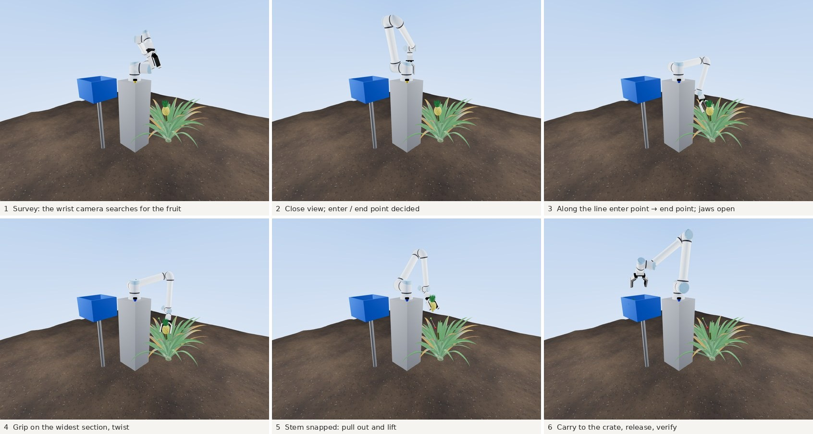

*Figure 8. One harvest cycle in B1, from the camera survey to the release in the crate.*

### 6.2 Field-scale execution (B3)

* **Carrier controller.** Separate from the arm policy: a proportional controller on the track speed (≤ 0.45 m/s)
  stops the carrier so that the next fruit is 1.0 m ahead of the arm base (window 0.30–1.12 m), where the ideal close
  view is reachable. The drift while standing was at most 0.6 mm.
* **Fruit memory.** Every perceived fruit is stored in the world frame from carrier odometry, including skipped ones
  (as obstacles). The next target is taken from memory; the survey runs only if the memory is empty or a remembered
  fruit is not found at the close view.
* **Level of detail.** Only the target, the previous and the next plant are physically interactive; a pool of
  interactive plant models is moved along the row and all other plants (including 384 plants of the neighbour beds)
  are static meshes. This keeps a 60-plant field computable on a CPU.
* **Skip recovery.** Any failure that is not a hard failure (collision, floor contact, timeout, numerical instability)
  skips the fruit: checked back-out, return to the default posture, next fruit. When both crates (8 fruits each) are
  full, an operator event empties them.

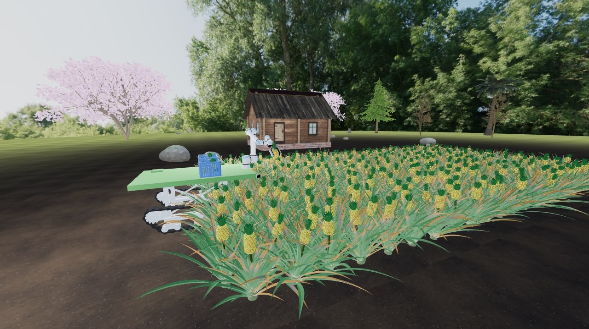

*Figure 9. B3: the tracked carrier with two crates and the UR10e harvesting one bed; neighbour beds are static.*

---

## 7. Outputs

| Level | Output |
|---|---|
| Every 20 ms | joint position targets $`q_{\text{cmd}} = q + \mathrm{clip}(\mathrm{IK}(p + \Delta p, q^{\ast}_{t+1}) - q, -0.25, 0.25)`$ |
| Every line | enter point, end point, validated route, decision record (candidates, votes, scores) |
| Every episode | outcome and failure reason, reward components, fruits in the crate, phase timings |
| Training | the deployable policy: the deterministic actor $`a_{\text{RL}} = \tanh(\mu_\phi(\hat o))`$ with the normalisation inside the graph, exported in ONNX format; replay of every evaluation as an interactive 3-D recording |

The deployed controller must reproduce the full loop around the exported actor: build the same 63-value observation,
run the same reference controller and gates, the same IK and send joint targets at 20 ms.

**Time per fruit (Stage B).** For every harvested fruit

```math
T_{\text{observe}\to\text{crate}} = (t_{\text{placed}} - t_{\text{start}}) + c_{\text{compute}},
```

where $`t_{\text{start}}`$ is the simulated time at which the robot starts to look for this fruit, $`t_{\text{placed}}`$ the
time the fruit is verified in the crate and $`c_{\text{compute}}`$ the real computing time spent on perception, decision and
planning for it. *Seconds per fruit* of a whole run is (simulated time + computing) / fruits in the crate and also
contains driving, returning home and time lost on failed fruits.

---

## 8. Validation

### 8.1 Protocol

* **Seed separation.** Checkpoint selection, validation and test use separate seed ranges that are never used for
  training decisions (Stage A: 50 fixed evaluation scenarios during training, 100 validation scenarios to choose between
  the best and the final model, 200 test scenarios, and a further independent set for the comparisons below; Stage B:
  validation seeds per mission and separate test seeds and field seeds).
* **Paired comparison.** "Reference alone" (that is, $`a_{\text{RL}} = 0`$) and "reference + RL" run on the *same* scenarios. The
  difference is judged on the scenarios where exactly one of them succeeds, with a two-sided exact sign test.
* **Checkpoint selection (Stage B).** Every evaluation interval the policy runs on fixed validation episodes; the best
  checkpoint (highest fruit rate, ties by mean return) is exported, not the last one. The reference alone runs on the
  same episodes before training, as the bar the policy has to beat.
* **Confidence interval.** 95 % Wilson score interval for a success proportion $`\hat p = k/n`$:

```math
\frac{\hat p + \frac{z^2}{2n} \pm z\left(\frac{\hat p(1-\hat p)}{n} + \frac{z^2}{4n^2}\right)^{1/2}}{1 + \frac{z^2}{n}},\qquad z = 1.96 .
```

* **Robustness conditions (Stage A).** Domain randomisation (payload, gravity) with observation noise; in A4–A5 also a
  perfect leaf map versus a simulated planning error (30 % of leaves missed, 2 cm noise).
* **Export check.** Every exported policy is compared with the training actor on real observations (tolerance 1e-4).

### 8.2 Stage A results

200 unseen scenarios per mission, final task, same scenarios for both rows.

| Mission | Reference alone | Reference + RL | Mean steps to success (ref → RL) | Paired result |
|---|---|---|---|---|
| A1, 5 mm | 90.0 % (85–93 %) | **100.0 %** (98–100 %) | 104.5 → 100.6 | the reference times out short of 5 mm in 20 scenarios; the correction removes all of them |
| A2, 2 cm | 100.0 % (98–100 %) | 100.0 % (98–100 %) | 143.6 → 128.3 | 11 % shorter motion |
| A3, 1 cm corridor | 99.5 % (97–100 %) | 100.0 % (98–100 %) | 147.8 → 141.2 | one collision removed, 4 % faster |
| A4 reach fruit (optional) | 83.0 % (77–88 %) | 84.0 % (78–88 %) | — | 5 vs 3 discordant scenarios, p = 0.73 |
| A5 full harvest (optional) | 61.0 % (54–67 %) | 60.5 % (54–67 %) | — | 13 vs 14, p = 1.00 |

Under domain randomisation and observation noise, A1 is 94.5 % → 100 % and A3 99.0 % → 99.0 %. A perfect leaf map raises
the reference alone by 9.5 points in A4 and 9.0 points in A5, more than the RL correction. In A5, 77 of the 78 failures of
the reference happen before the fruit is detached.

### 8.3 Stage B results

| Evaluation | Policy | Fruits in the crate | Observe → crate (mean / max) |
|---|---|---|---|
| B1, 30 test episodes, realistic plants | reference alone | 29 / 30 (83–99 %) | 25.3 s / 36.1 s |
| B2, 20 test episodes (40 fruits) | reference alone | 37 / 40 (80–97 %) | 21.2 s / 30.6 s |
| B3, full row, 1 neighbour bed per side | reference alone | 59 / 60 (91–100 %) | 23.2 s / 34.4 s |
| **B3, full row, 3 neighbour beds per side** | **reference + residual SAC (exported)** | **56 / 60 (93.3 %, 84–97 %)** | **27.0 s / 47.9 s** |

The two full-row runs differ in more than the policy (number of neighbour beds, machine), so they do not isolate the
effect of the correction. In the full row with the exported policy the arm attempted 60 fruits, gripped 59, snapped 58
stems and placed 56; the carrier made 55 stops over 15.13 m; the median error of the camera estimate of the fruit centre
was 0.61 cm; no leaf was torn out. All four lost fruits were lost in the scripted grip and pull-out, after the learned
phases had ended (two grasp misses, two fruits pushed out of the grip by the stalk or a leaf).

During training the exported checkpoints compare with the reference alone on the validation episodes as follows:
B1 9/10 vs 9/10 episodes (equal), B2 10/12 vs 9/12 fruits, B3 8/8 vs 7/8 fruits. In B1, 24 of 30 checkpoints equal the
reference and none exceeds it; in B3, 46 of 50 checkpoints equal it. These differences are single episodes and not
significant, and the rolling training success does not rise in any mission.

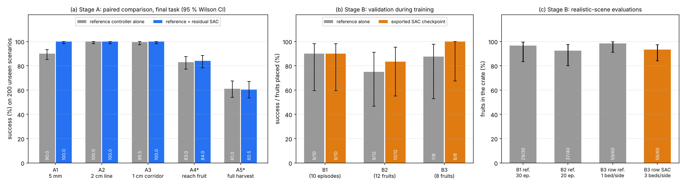

*Figure 10. Validation summary with 95 % Wilson intervals. (a) Stage A paired comparison. (b) Stage B validation of the
exported checkpoints against the reference alone. (c) Stage B evaluations with realistic plants.*

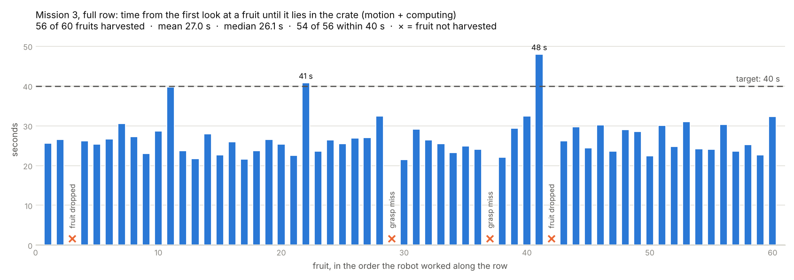

*Figure 11. B3 full row with the exported policy: time from the first look at a fruit until it lies in the crate
(motion + computing). 54 of the 56 harvested fruits took less than 40 s.*

### 8.4 End-point selector

On the 485 held-out views of the pretraining data:

| Selector | Mean true clearance of the chosen line |
|---|---|
| random candidate | 5.74 cm |
| camera-clearance heuristic | 8.60 cm |
| **diffusion policy** | **8.61 cm** |
| oracle (true leaf geometry) | 8.80 cm |

The diffusion policy picks the best candidate in 93.6 % of the views. It matches the heuristic and is within 2 mm of the
oracle; it does not beat the heuristic on average.

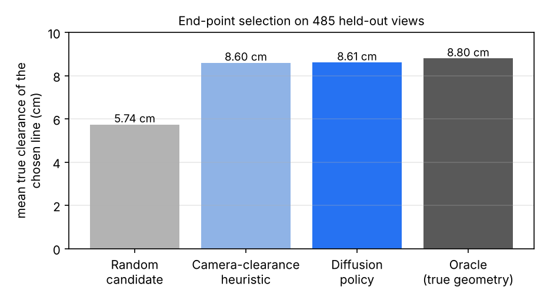

*Figure 12. True clearance of the line chosen by each selector on held-out views.*

### 8.5 Interpretation

* **Where the learned correction helps.** Precision and speed in free space: in A1 it turns 90 % into 100 % at 5 mm,
  because the fixed-gain reference stalls short of a 5 mm target in some configurations; in A2 it shortens the motion
  by 11 %.
* **Where it does not.** Once the line is validated (A3) or planned through leaves (A4–A5, Stage B), the hard part of
  the problem — where to go so that nothing is hit — is already solved, and the correction ties the reference. The
  remaining failures are physical (a leaf that must be bent, a twist the wrist cannot reach, a grip that slips) and lie
  in phases where the correction is switched off.
* **What the performance of Stage B comes from.** Perception (early-stop survey, one close view, camera check at the
  enter point), line selection and the guarded scripted harvest. Their redesign raised B1 from 8/12 to 29/30 episodes and
  cut the time per fruit to about a third, without changing the learned part.
* The algorithm is therefore best described as **residual reinforcement learning on top of a planner**, not as
  end-to-end reinforcement learning.

### 8.6 Cross-engine replay check (NVIDIA Isaac Sim)

To check that the results are not tied to one simulation environment's data format, the recorded state trajectory of
one B3 full-row evaluation (pose of every body at 25 Hz, visibility of picked fruits and crate contents, cameras and
the enter/end-point decision of every fruit) was exported as a time-sampled OpenUSD stage for **NVIDIA Isaac Sim**,
together with a script that renders the four cameras (follow, corner, wrist, overview) into one video frame. The USD
geometry was compared with the recorded states at sampled frames: the largest bounding-box deviation of any mesh was
2.2 mm, and every visibility state matched. The replay is kinematic: it shows the recorded motion, it does not
re-simulate contacts or retrain the policy in Isaac Sim or Isaac Lab. The run in the replay package is a later B3
run that replaces the twist of Section 6.1 by a sideways snap while lifting; its numbers are not part of Section 8.3.

---

## 9. Limitations

* Simulation only; no real-robot results. Latency and the robot controller's own dynamics are not randomised.
* Stage A uses exact target and obstacle positions; Stage B models camera noise but uses one fixed camera model and
  colour thresholds tuned to the simulated rendering.
* The residual policy depends on a validated route: where no collision-free route can be computed, neither the
  reference nor the correction is guaranteed to succeed.
* Plant geometry, leaf stiffness, stem break values and pad friction are estimates and must be replaced by measurements
  before sim-to-real claims are made.
* Stage B results are mostly single field runs and short validation sets; their intervals are wide.

---

## References

Journal articles

1. E. B. Wilson. Probable inference, the law of succession, and statistical inference. *Journal of the American Statistical Association*, 22(158):209–212, 1927. doi:10.1080/01621459.1927.10502953.
2. S. R. Buss, J.-S. Kim. Selectively damped least squares for inverse kinematics. *Journal of Graphics Tools*, 10(3):37–49, 2005.

Peer-reviewed conference proceedings

3. Y. Bengio, J. Louradour, R. Collobert, J. Weston. Curriculum learning. In *Proceedings of the 26th International Conference on Machine Learning (ICML)*, pp. 41–48, 2009. doi:10.1145/1553374.1553380.
4. A. Y. Ng, D. Harada, S. Russell. Policy invariance under reward transformations: theory and application to reward shaping. In *Proceedings of the 16th International Conference on Machine Learning (ICML)*, pp. 278–287, 1999.
5. T. Haarnoja, A. Zhou, P. Abbeel, S. Levine. Soft actor-critic: off-policy maximum entropy deep reinforcement learning with a stochastic actor. In *Proceedings of the 35th International Conference on Machine Learning (ICML)*, PMLR 80:1861–1870, 2018.
6. T. Johannink, S. Bahl, A. Nair, J. Luo, A. Kumar, M. Loskyll, J. A. Ojea, E. Solowjow, S. Levine. Residual reinforcement learning for robot control. In *IEEE International Conference on Robotics and Automation (ICRA)*, pp. 6023–6029, 2019. arXiv:1812.03201.
7. S. Fujimoto, S. S. Gu. A minimalist approach to offline reinforcement learning. In *Advances in Neural Information Processing Systems 34 (NeurIPS)*, 2021. arXiv:2106.06860.
8. Y. Zhou, C. Barnes, J. Lu, J. Yang, H. Li. On the continuity of rotation representations in neural networks. In *Proceedings of the IEEE/CVF Conference on Computer Vision and Pattern Recognition (CVPR)*, pp. 5745–5753, 2019. doi:10.1109/CVPR.2019.00589.
9. J. Ho, A. Jain, P. Abbeel. Denoising diffusion probabilistic models. In *Advances in Neural Information Processing Systems 33 (NeurIPS)*, 2020. arXiv:2006.11239.
10. J. Song, C. Meng, S. Ermon. Denoising diffusion implicit models. In *International Conference on Learning Representations (ICLR)*, 2021. arXiv:2010.02502.
11. A. Q. Nichol, P. Dhariwal. Improved denoising diffusion probabilistic models. In *Proceedings of the 38th International Conference on Machine Learning (ICML)*, PMLR 139:8162–8171, 2021.
12. C. Chi, S. Feng, Y. Du, Z. Xu, E. Cousineau, B. Burchfiel, S. Song. Diffusion policy: visuomotor policy learning via action diffusion. In *Robotics: Science and Systems XIX (RSS)*, 2023. arXiv:2303.04137.

Preprints (not peer reviewed)

13. T. Haarnoja, A. Zhou, K. Hartikainen, G. Tucker, S. Ha, J. Tan, V. Kumar, H. Zhu, A. Gupta, P. Abbeel, S. Levine. Soft actor-critic algorithms and applications. arXiv preprint arXiv:1812.05905, 2018.
14. T. Silver, K. Allen, J. Tenenbaum, L. Kaelbling. Residual policy learning. arXiv preprint arXiv:1812.06298, 2018.
